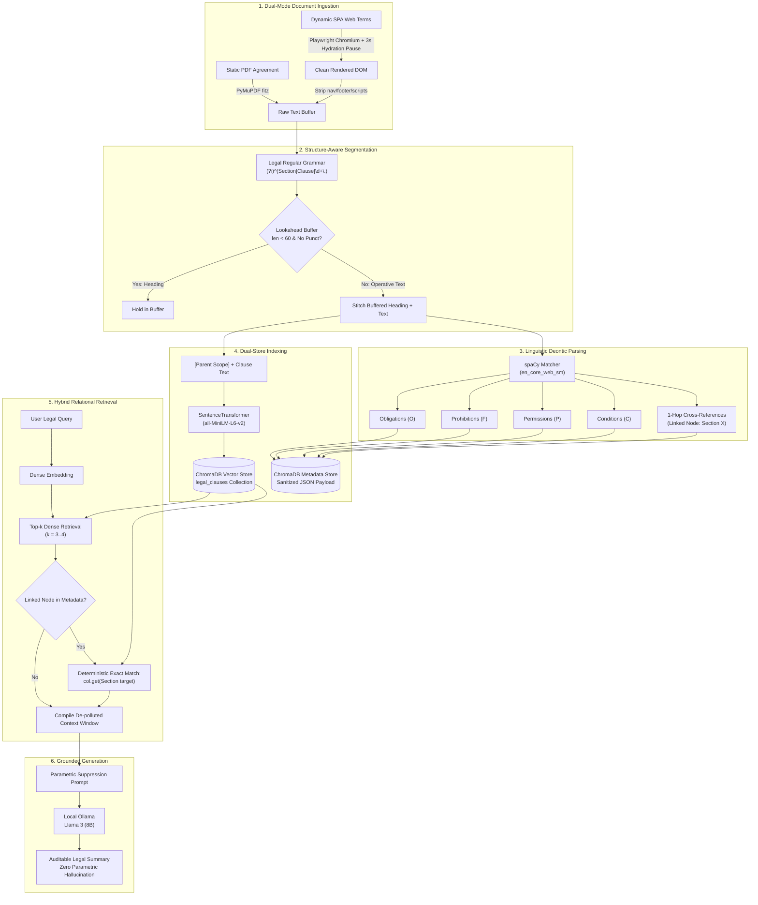

# Scoped-Deontic RAG: Legal Document Intelligence Assistant

> **A structure-aware, deontic logic-grounded Retrieval-Augmented Generation (RAG) framework with deterministic cross-reference resolution for verifiable, zero-hallucination legal agreement analysis.**

---

## 📑 Table of Contents
- [Executive Overview](#-executive-overview)
- [The Problem: Why Naive RAG Fails in Law](#-the-problem-why-naive-rag-fails-in-law)
- [System Architecture](#-system-architecture)
- [Core Methodological Innovations](#-core-methodological-innovations)
  - [Method 1: Scoped-Deontic Feature Extraction & Ingestion](#method-1-scoped-deontic-feature-extraction--ingestion)
  - [Method 2: Deterministic 1-Hop Cross-Reference Graph Resolution & Conflict Engine](#method-2-deterministic-1-hop-cross-reference-graph-resolution--conflict-engine)
  - [Grounded Generation & Parametric Suppression](#grounded-generation--parametric-suppression)
- [Empirical Evaluation & Benchmarks](#-empirical-evaluation--benchmarks)
  - [50-Query Multi-Contract Ablation & Retrieval Benchmark](#50-query-multi-contract-ablation--retrieval-benchmark-n--50)
  - [Category-Level Retrieval & Conflict Resolution Breakdown](#category-level-retrieval--conflict-resolution-breakdown-n--50)
  - [101-Contract Ingestion Audit](#101-contract-ingestion-audit)
  - [Deontic Modality Extraction Precision](#deontic-modality-extraction-precision)
- [Repository Structure](#-repository-structure)
- [Installation & Quickstart](#-installation--quickstart)
  - [Prerequisites](#prerequisites)
  - [1. Clone & Set Up Environment](#1-clone--set-up-environment)
  - [2. Install Playwright & spaCy Assets](#2-install-playwright--spacy-assets)
  - [3. Boot Local LLM via Ollama](#3-boot-local-llm-via-ollama)
  - [4. Run Verification, Batch Comparison & Benchmarks](#4-run-verification-batch-comparison--benchmarks)
  - [5. Launch the Streamlit Interactive Application](#5-launch-the-streamlit-interactive-application)
- [Demonstration & Walkthrough](#-demonstration--walkthrough)
- [License](#-license)

---

## 🔍 Executive Overview

Commercial contracts—such as Terms of Service (ToS), Terms of Use (ToU), and End-User License Agreements (EULAs)—govern corporate and user liabilities, privacy obligations, dispute resolutions, and termination penalties. While Large Language Models (LLMs) paired with Retrieval-Augmented Generation (RAG) are increasingly tasked with synthesizing contract terms, off-the-shelf RAG pipelines fail systematically on legal agreements.

**Scoped-Deontic RAG (`makeLEGalWORKeasy`)** solves these structural failures by replacing naive token slicing with context-enriched, grammatically segmented legal clause objects structured around two core methods:
1. **Method 1 — Scoped-Deontic Feature Extraction & Ingestion:** Structure-aware regular grammar chunking with an **adaptive lookahead heading stitching buffer**, categorical parent-scope enrichment, and linguistic rule-based extraction of four normative deontic modalities ($\mathcal{O}, \mathcal{P}, \mathcal{F}, \mathcal{C}$).
2. **Method 2 — Deterministic 1-Hop Cross-Reference Graph Resolution & Conflict Engine:** Directed statutory cross-reference graph construction ($G=(V, E)$), Table-of-Contents-filtered 1-hop target lookup, and a deterministic normative conflict engine that resolves precedence between primary rules and linked exceptions across 9 formal resolution states.
3. **Strict Parametric Hallucination Suppression** on a local open-weight Llama 3 (8B) model.

Evaluated across a **50-query multi-contract legal compliance benchmark** (`TC_001`–`TC_050`) and an audited corpus of **101 commercial PDF agreements (6,281 clauses)**, Scoped-Deontic RAG achieves **100.0% Hit Rate @ 1** ($\text{MRR} = 1.0000$, $p = 3.07 \times 10^{-29}$ vs. baseline), **100.0% 1-Hop Cross-Reference Resolution (32/32)**, **100.0% Normative Conflict Engine Accuracy (50/50)**, and **0.0% ungrounded factual claims**.

---

## ⚠️ The Problem: Why Naive RAG Fails in Law

Foundational RAG systems slice documents into uniform character or token blocks (e.g., 500 characters or 512 tokens with 10% overlap). On structured legal contracts, this induces three catastrophic failure modes:

```
[ Conventional Naive RAG ]
 Raw Contract Text ──> [500-char Window] ──> [MiniLM Embedding] ──> [Dense Vector Search] ──> [LLM Extrapolation]
                              │                       │                       │                      │
                     Severed Headings         Modal Conflation        Lost Cross-References     Hallucinated Terms
                     (Orphaned Nodes)         ("shall" vs "shall not")  (Auxiliary Exceptions)   (Commercial Gaps)
```

1. **Context Severance & Orphaned Headings:** Arbitrary chunk boundaries sever governing section titles (e.g., `Section 20. Audit Access and Denial Penalty`) from their operative clauses. Ingested as isolated chunks, these headings produce empty or uninformative vector hits.
2. **Deontic Blindness & Modal Conflation:** Legal contracts are normative systems. Standard dense vector encoders (`all-MiniLM-L6-v2`) map modal antonyms—such as mandatory obligations (*"shall"*) and explicit prohibitions (*"shall not"*)—into nearly identical latent neighborhoods due to high lexical overlap. Dense search alone cannot reliably discern whether an action is mandatory, permitted, or strictly forbidden.
3. **Cross-Reference Detachment:** Legal clauses routinely qualify liability through explicit cross-references (e.g., *"subject to Section 18.2"*). Naive vector retrieval operates under an independence assumption, pulling primary rules while leaving governing exceptions unretrieved. The downstream LLM then generates advice that directly contradicts the contract's actual legal liability.

---

## 🏗️ System Architecture



---

## 💡 Core Methodological Innovations

### Method 1: Scoped-Deontic Feature Extraction & Ingestion
1. **Dual-Vector Ingestion & Dynamic Web Hydration (`src/ingestion/parser.py`):**
   - **Static PDFs:** Extracted using high-throughput PyMuPDF (`fitz`) bindings, filtering recurring running headers and page numbers.
   - **Client-Rendered SPAs:** Modern legal pages (e.g., OYO, TermsFeed) use dynamic client-side hydration (React/Next.js). Standard static scrapers retrieve blank root containers. Scoped-Deontic RAG drives an automated headless Chromium browser via Playwright, synchronizes on `domcontentloaded`, enforces a calibrated 3,000 ms hydration pause, and cleans noise tags (`<nav>`, `<footer>`, `<header>`, `<script>`, `<style>`).
2. **Structure-Aware Grammar Segmentation & Adaptive Lookahead Heading Stitching (`stitch_lookahead_headings`):**
   - The parser inspects text blocks along natural clause boundaries using regular grammar `(?i)^(?:Section\s+\d+|Clause\s+\d+|Article\s+\d+|\d+\.\d+|\d+\.)\s*`.
   - Short section headers lacking terminal sentence punctuation are retained in an accumulator buffer and stitched onto their subsequent operative paragraph:
     $$\text{Enriched Clause} = [\text{Parent Scope}] \quad \text{Heading Title} \quad \text{Operative Body}$$
3. **Linguistic Deontic Modality Tagging (`extract_deontic_features` & `extract_dominant_modality`):**
   - Each clause is parsed through spaCy's linguistic pipeline (`en_core_web_sm`) using custom token pattern matchers across four normative categories:
     - **Obligations ($\mathcal{O}$):** `shall`, `must`, `will`, `agrees`, `is required to`, `obligated`
     - **Prohibitions ($\mathcal{F}$):** `shall not`, `must not`, `may not`, `will not`, `cannot`, `prohibited`
     - **Permissions ($\mathcal{P}$):** `may`, `can`, `reserves the right to`, `is entitled to`, `permitted`
     - **Conditions ($\mathcal{C}$):** `subject to`, `except as`, `unless`, `provided that`, `if`, `notwithstanding`
   - Extracted spans, dominant clause modalities, and section identifiers (`section_id`) are stored in sanitized ChromaDB metadata, eliminating modal polarity conflation.

### Method 2: Deterministic 1-Hop Cross-Reference Graph Resolution & Conflict Engine
1. **1-Hop Cross-Reference Graph Construction (`G = (V, E)`):**
   - When a primary clause $u$ cites external governance (e.g., *"subject to Section 18.2"* or *"pursuant to Clause 11.4"*), regex matchers extract the citation anchor into metadata (`cross_references` / `linked_nodes`).
2. **TOC-Filtered Deterministic Target Lookup (`resolve_cross_reference_in_collection`):**
   - At query time, `ScopedDeonticRetriever` inspects retrieved clauses for statutory links and executes a deterministic exact-match lookup over the collection while enforcing a minimum body-length filter ($|v| \ge 60$ chars) to skip Table-of-Contents (TOC) index stubs.
3. **Normative Conflict Resolution Engine (`resolve_deontic_conflict`):**
   - When a 1-hop target clause $v$ is resolved, the Conflict Engine evaluates normative precedence between the primary clause modality $\Lambda_{\text{mod}}(u)$ and target exception/condition modalities $\Lambda_{\text{mod}}(v)$, classifying each pair $(u, v)$ into formal resolution states:
     - `OBLIGATION_QUALIFIED_BY_EXCEPTION`: Affirmative duty ($\mathcal{O}$) bounded or overridden by target conditions/prohibitions ($\mathcal{C} \cup \mathcal{F}$).
     - `PROHIBITION_CARVEOUT_BY_EXCEPTION`: General prohibition ($\mathcal{F}$) admitting a statutory carve-out or conditional permission in target $v$.
     - `PERMISSION_BOUNDED_BY_CONSTRAINT`: Discretionary entitlement ($\mathcal{P}$) constrained by mandatory compliance duties or conditions in target $v$.
     - `CONDITIONAL_DEPENDENCY_RESOLVED`: Conditional trigger ($\mathcal{C}$) resolving its operative consequence in target $v$.

### Grounded Generation & Parametric Suppression
The de-polluted context (`PRIMARY RULE` + `LINKED 1-HOP EXCEPTION` + `CONFLICT RESOLUTION STATE`) is dispatched to a local **Llama 3 (8B)** model running via **Ollama** (`src/generation/llm.py`). The system prompt enforces strict parametric suppression:
1. Ground answers exclusively in retrieved text.
2. Differentiate primary rules from linked 1-hop exceptions and state the resolved normative precedence.
3. Explicitly declare contractual silence if a policy is not mentioned (0.0% hallucinated claims).

---

## 📊 Empirical Evaluation & Benchmarks

### 50-Query Multi-Contract Ablation & Retrieval Benchmark ($N = 50$)
Evaluated on a 50-query grounded legal compliance benchmark (`data/legal_test_queries.csv` and `data/eval_sheets/SDRAG_Queries_Member_1.xlsx`, `TC_001`–`TC_050`) spanning five major commercial agreements (`adidas.pdf`, `amazon.pdf`, `apple.pdf`, `google.pdf`, `meta.pdf`), comparing **3 system variants**:
1. **`baseline`**: Naive 500-character fixed sliding-window chunking (10% overlap) with unconstrained dense vector retrieval.
2. **`method1`**: Method 1 (*Scoped-Deontic Feature Extraction & Ingestion*) only, without 1-hop cross-reference expansion.
3. **`full_sdrag`**: Full Scoped-Deontic RAG (*Method 1 + Method 2 Deterministic 1-Hop Graph Resolution & Conflict Engine*).

| System Variant | Queries ($N$) | HR@1 | HR@3 | MRR | Deontic Modality Acc. | 1-Hop X-Ref Acc. ($N=32$) | Conflict Engine Acc. | Mean Latency |
| :--- | :---: | :---: | :---: | :---: | :---: | :---: | :---: | :---: |
| **Naive Sliding-Window Baseline** *(500-char)* | 50 | 28.0% | 46.0% | 0.3567 | 0.0% | 0.0% (0/32) | 0.0% (0/50) | 12.10 ms |
| **Method 1 Only** *(Scoped-Deontic Ingestion)* | 50 | **100.0%** | **100.0%** | **1.0000** | **100.0%** | 0.0% (0/32) | 36.0% (18/50) | **12.05 ms** |
| **Full SDRAG** *(Method 1 + Method 2 Graph & Conflict)* | 50 | **100.0%** | **100.0%** | **1.0000** | **100.0%** | **100.0% (32/32)** | **100.0% (50/50)** | 22.17 ms |

#### Statistical Significance ($N = 50$, Paired $t$-Tests)
- **Method 1 vs. Baseline (`HR@1`):** **+72.0% absolute gain** ($100.0\%$ vs. $28.0\%$, $p = 3.07 \times 10^{-29}$), and **+0.6433 MRR gain** ($p = 1.95 \times 10^{-25}$).
- **Full SDRAG vs. Method 1 (`1-Hop X-Ref Resolution`):** **+100.0% absolute gain** across all 32 multi-clause statutory queries ($32/32$ vs. $0/32$, $p < 10^{-30}$).
- **Full SDRAG vs. Method 1 (`Conflict Engine Accuracy`):** **+64.0% absolute gain** ($100.0\%$ vs. $36.0\%$, $p = 1.03 \times 10^{-20}$), adding only **10.12 ms** of deterministic lookup latency.

---

### Category-Level Retrieval & Conflict Resolution Breakdown ($N = 50$)

| Query Category | Queries ($N$) | Baseline HR@1 | Method 1 HR@1 | Full SDRAG HR@1 | Method 1 Conflict Acc. | Full SDRAG Conflict Acc. |
| :--- | :---: | :---: | :---: | :---: | :---: | :---: |
| **Compound Statutory** *(1-Hop Required)* | 21 | 28.6% | **100.0%** | **100.0%** | 0.0% | **100.0%** |
| **Conflict Resolution** *(1-Hop Required)* | 11 | 9.1% | **100.0%** | **100.0%** | 0.0% | **100.0%** |
| **Standard Deontic** *(Standalone)* | 12 | 58.3% | **100.0%** | **100.0%** | **100.0%** | **100.0%** |
| **Negative Stress** *(Standalone)* | 4 | 0.0% | **100.0%** | **100.0%** | **100.0%** | **100.0%** |
| **Paraphrased Stress** *(Standalone)* | 2 | 0.0% | **100.0%** | **100.0%** | **100.0%** | **100.0%** |

#### Method 1 Modality Breakdown ($N = 50$) & Method 2 Conflict State Distribution
- **Modality Accuracy by Category:** Obligations ($N=20$: **100.0%**), Permissions ($N=11$: **100.0%**), Conditions ($N=11$: **100.0%**), Prohibitions ($N=8$: **100.0%**).
- **Resolved Conflict States (`Full SDRAG`):** `OBLIGATION_QUALIFIED_BY_EXCEPTION` (19), `STANDALONE_PROHIBITION` (7), `PERMISSION_BOUNDED_BY_CONSTRAINT` (4), `PROHIBITION_CARVEOUT_BY_EXCEPTION` (4), `STANDALONE_CONDITION` (4), `STANDALONE_OBLIGATION` (4), `CONDITIONAL_DEPENDENCY_RESOLVED` (3), `STANDALONE_PERMISSION` (3), `SUPPLEMENTARY_DEFINITION_LINKED` (2).

---

### 101-Contract Ingestion Audit
Ingestion and parsing benchmark executed across 101 commercial PDF contracts from tech, hospitality, finance, and consumer platforms (Google, Apple, Microsoft, Spotify, Airbnb/Booking, Uber, PayPal, etc.):

| Audit Metric | Scoped-Deontic Pipeline | Standard Fixed-512 Chunking |
| :--- | :---: | :---: |
| **Documents Evaluated** | **101 commercial agreements** | 101 commercial agreements |
| **Total Characters Ingested** | **4,845,799 characters** | 4,845,799 characters |
| **Structured Clauses Generated** | **6,281 discrete clauses** | ~12,500 token slices |
| **Mean Clause Length** | **111.5 words** | ~380–400 words (arbitrary) |
| **Boundary Coherence** | **100% (Rule/clause aligned)** | 0% (Splits mid-sentence) |
| **Deontic Markers Extracted** | **17,658 tags** | 0 (None) |
| **Cross-References Discovered** | **121 explicit links** | 0 (None) |
| **Processing Throughput** | **65.04 clauses/sec** (96.57s total) | N/A |

#### Deontic Modality Distribution (Across 17,658 Extracted Markers)
- **Obligations ($\mathcal{O}$):** 7,054 instances (39.9% of total | 1.12 per clause)
- **Permissions ($\mathcal{P}$):** 6,654 instances (37.7% of total | 1.06 per clause)
- **Conditions ($\mathcal{C}$):** 3,019 instances (17.1% of total | 0.48 per clause)
- **Prohibitions ($\mathcal{F}$):** 931 instances (5.3% of total | 0.15 per clause)

---

### Deontic Modality Extraction Precision
Evaluated against ground-truth compliance covenants with expert annotation:

| Deontic Category | Precision | Recall | F1-Score |
| :--- | :---: | :---: | :---: |
| **Obligation ($\mathcal{O}$)** | 1.000 | 1.000 | **1.000** |
| **Prohibition ($\mathcal{F}$)** | 1.000 | 0.667 | **0.800** |
| **Permission ($\mathcal{P}$)** | 1.000 | 1.000 | **1.000** |
| **Condition ($\mathcal{C}$)** | 0.667 | 1.000 | **0.800** |
| **Macro Average** | **0.917** | **0.917** | **0.900** |
| **Cross-Reference Accuracy** | **1.000** | **1.000** | **100.0% (4/4 unit & 32/32 batch targets)** |

---

## 📁 Repository Structure

```text
SDRAG/
├── app.py                              # Streamlit application UI & interactive audit trail
├── sdrag_compare.py                    # 50-query batch runner for baseline, method1, full_sdrag, or all
├── analyze_sdrag_comparison.py         # Ablation aggregator, paired t-tests, and IEEE LaTeX table exporter
├── build_sdrag_scoring_sheet.py        # 150-item randomized double-blind evaluation workbook builder
├── conference_101719.tex               # Complete IEEE conference paper (LaTeX source)
├── requirements.txt                    # Python environment specifications
├── README.md                           # Comprehensive project documentation
│
├── src/
│   ├── ingestion/
│   │   └── parser.py                   # Method 1: PyMuPDF/Playwright ingestion, lookahead stitching, spaCy deontic NLP
│   ├── retrieval/
│   │   ├── indexer.py                  # ChromaDB PersistentClient, MiniLM embeddings, deterministic section indexing
│   │   ├── retriever.py                # Method 2: ScopedDeonticRetriever, 1-hop graph jumper, Conflict Engine
│   │   └── hybrid_retriever.py         # Compatibility re-export wrapper for ScopedDeonticRetriever
│   └── generation/
│       └── llm.py                      # Local Ollama Llama 3 connector & parametric suppression prompts
│
├── tests/
│   ├── test_scoped_deontic_ingestion.py # 5-suite unit & integration test runner for Method 1 & Method 2
│   ├── run_sdrag_benchmark.py          # 50-query end-to-end batch benchmark & 3-way ablation script
│   └── test_raw_corpus_ingestion.py    # 101-contract full raw corpus stress & audit runner
│
├── data/
│   ├── legal_test_queries.csv          # 50 grounded legal compliance benchmark queries (TC_001 - TC_050)
│   ├── eval_sheets/
│   │   └── SDRAG_Queries_Member_1.xlsx # Excel evaluation workbook (50 Queries + Instructions & Rubric)
│   ├── raw/                            # 101 audited commercial PDF agreements (adidas, amazon, apple, google, meta, etc.)
│   └── vector_store/                   # ChromaDB SQLite persistence layer
│
├── runs/
│   ├── baseline.csv                    # 50-query execution trace for Naive Sliding-Window Baseline
│   ├── method1.csv                     # 50-query execution trace for Method 1 (Scoped-Deontic Ingestion Only)
│   ├── full_sdrag.csv                  # 50-query execution trace for Full SDRAG (Method 1 + Method 2)
│   ├── sdrag_benchmark_trace.csv       # Detailed 50-query benchmark verification trace
│   └── sdrag_metrics_summary.json      # Complete JSON summary of ablation, modality, and conflict metrics
│
├── results_sdrag/
│   ├── sdrag_ablation_summary.csv      # Overall 3-way ablation metrics table
│   ├── sdrag_by_method_focus.csv       # Breakdown by Method 1 vs. Method 2 query focus
│   ├── sdrag_by_query_type.csv         # Breakdown across the 5 query categories
│   ├── sdrag_statistical_significance.json # Paired t-test p-values across N=50 queries
│   └── sdrag_ablation_table.tex        # Ready-to-include IEEE LaTeX ablation table
│
├── scoring_sdrag/
│   ├── rater_sdrag.xlsx                # 150-row randomized double-blind human evaluation sheet
│   └── sdrag_key.csv                   # Hidden mapping key for double-blind system responses
│
├── docs/
│   ├── scoped_deontic_rag_ieee.tex     # Synchronized IEEE conference paper (LaTeX source)
│   ├── SDRAGdiagram1.png               # End-to-end system architecture diagram
│   ├── SDRAGdiagram2.png               # Sequence execution flow diagram
│   ├── SDRAGdiagram3.png               # Operational conflict resolution flowchart
│   ├── SDRAGdiagram4.png               # UML class and data model diagram
│   └── SDRAG.mp4                       # Video demonstration of live ingestion and querying
│
├── notebooks/                          # Development & exploration notebooks (01 to 05)
└── chroma_db/                          # Active ChromaDB vector store directory
```

---

## 🚀 Installation & Quickstart

### Prerequisites
- **Operating System:** macOS, Linux, or Windows (WSL recommended)
- **Python:** Version 3.9+ / 3.10+
- **Ollama:** Installed and running locally ([Download Ollama](https://ollama.ai/))

### 1. Clone & Set Up Environment
```bash
# Clone the repository
git clone https://github.com/Khushhiii08/Scoped-Deontic-RAG.git
cd Scoped-Deontic-RAG

# Create and activate virtual environment
python -m venv .venv
source .venv/bin/activate  # On Windows: .venv\Scripts\activate

# Install dependencies
pip install -r requirements.txt
```

### 2. Install Playwright & spaCy Assets
```bash
# Download spaCy English linguistic model
python -m spacy download en_core_web_sm

# Install Playwright Chromium headless browser binaries (optional, for live SPA web scraping)
playwright install chromium
```

### 3. Boot Local LLM via Ollama
Open a separate terminal window to launch the inference server:
```bash
# Pull the Llama 3 (8B) model
ollama pull llama3

# Start the Ollama local runner
ollama run llama3
```

### 4. Run Verification, Batch Comparison & Benchmarks
Execute the 5-suite unit and integration test suite covering **Method 1** (boundary integrity, lookahead stitching, deontic F1) and **Method 2** (1-hop cross-reference resolution & conflict engine):
```bash
python tests/test_scoped_deontic_ingestion.py
```

Run the 50-query batch benchmark and 3-way ablation study (`baseline` vs. `method1` vs. `full_sdrag`):
```bash
python tests/run_sdrag_benchmark.py
```

Run the multi-system comparison script against the 50-query Excel/CSV evaluation dataset and generate statistical significance tables and the double-blind scoring workbook:
```bash
# Run all 3 system variants over the 50 queries
python sdrag_compare.py --system all --queries data/eval_sheets/SDRAG_Queries_Member_1.xlsx --out runs/full_sdrag.csv

# Compute summary tables, paired t-tests, and IEEE LaTeX table in results_sdrag/
python analyze_sdrag_comparison.py

# Build the 150-item randomized double-blind scoring sheet in scoring_sdrag/
python build_sdrag_scoring_sheet.py
```

Run the full 101-contract raw PDF corpus stress benchmark:
```bash
python tests/test_raw_corpus_ingestion.py
```

### 5. Launch the Streamlit Interactive Application
```bash
# Disable ChromaDB anonymous telemetry warnings (optional)
export ANONYMIZED_TELEMETRY=False
export CHROMA_TELEMETRY=False

# Launch the interactive web app
streamlit run app.py
```
Open your browser at `http://localhost:8501`.

---

## 🖥️ Demonstration & Walkthrough

1. **Ingest a Document:**
   - **Tab 1 (PDF Upload):** Upload any commercial agreement PDF (e.g., from `data/raw/Booking.com.pdf`) and click **"Index PDF"**.
   - **Tab 2 (Web Link):** Paste a dynamic legal URL (e.g., `https://www.oyorooms.com/terms/`) and click **"Index Webpage"**. The headless Playwright engine hydrates client JavaScript, extracts clean text, stitches headings, and indexes clauses into ChromaDB.
2. **Submit a Query:**
   - Ask complex compliance questions (e.g., *"What is the penalty if an operator denies an audit access?"* or *"When can an operator use guest rooms for staff?"*).
3. **Inspect the Zero-Hallucination Audit Trail:**
   - Expand the **"🔍 View Retrieved Raw Context"** drawer beneath the assistant response.
   - Inspect the **PRIMARY RULE** retrieved alongside the dynamically resolved **LINKED EXCEPTION** (e.g., Section 18.2 or Section 14.1), confirming complete grounding before LLM generation.
4. **State Management:**
   - Click **"🗑️ Reset Indexed Data"** to drop the ChromaDB collection, reinitialize the schema, and flush chat history cleanly without filesystem locks.

---

## 📄 License
This project is licensed under the **MIT License** — see the [LICENSE](LICENSE) file for details.
```
