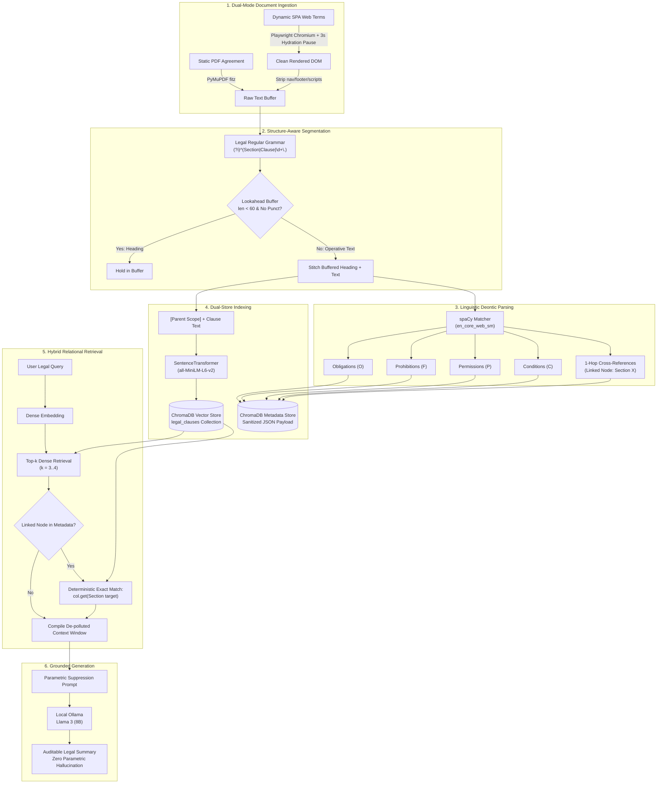

# Scoped-Deontic RAG: Legal Document Intelligence Assistant

> **A structure-aware, deontic logic-grounded Retrieval-Augmented Generation (RAG) framework with deterministic cross-reference resolution for verifiable, zero-hallucination legal agreement analysis.**

---

## 📑 Table of Contents
- [Executive Overview](#-executive-overview)
- [The Problem: Why Naive RAG Fails in Law](#-the-problem-why-naive-rag-fails-in-law)
- [System Architecture](#-system-architecture)
- [Core Methodological Innovations](#-core-methodological-innovations)
  - [1. Dual-Vector Ingestion & Dynamic Web Hydration](#1-dual-vector-ingestion--dynamic-web-hydration)
  - [2. Lookahead Heading Stitching](#2-lookahead-heading-stitching)
  - [3. Linguistic Deontic Modality Tagging](#3-linguistic-deontic-modality-tagging)
  - [4. Deterministic 1-Hop Cross-Reference Graph Traversal](#4-deterministic-1-hop-cross-reference-graph-traversal)
  - [5. Grounded Generation & Parametric Suppression](#5-grounded-generation--parametric-suppression)
- [Empirical Evaluation & Benchmarks](#-empirical-evaluation--benchmarks)
  - [Diagnostic Retrieval Evaluation](#diagnostic-retrieval-evaluation)
  - [101-Contract Ingestion Audit](#101-contract-ingestion-audit)
  - [Deontic Modality Extraction Precision](#deontic-modality-extraction-precision)
- [Repository Structure](#-repository-structure)
- [Installation & Quickstart](#-installation--quickstart)
  - [Prerequisites](#prerequisites)
  - [1. Clone & Set Up Environment](#1-clone--set-up-environment)
  - [2. Install Playwright & spaCy Assets](#2-install-playwright--spacy-assets)
  - [3. Boot Local LLM via Ollama](#3-boot-local-llm-via-ollama)
  - [4. Run Verification & Ingestion Benchmarks](#4-run-verification--ingestion-benchmarks)
  - [5. Launch the Streamlit Interactive Application](#5-launch-the-streamlit-interactive-application)
- [Demonstration & Walkthrough](#-demonstration--walkthrough)
- [Citation](#-citation)
- [License](#-license)

---

## 🔍 Executive Overview

Commercial contracts—such as Terms of Service (ToS), Terms of Use (ToU), and End-User License Agreements (EULAs)—govern corporate and user liabilities, privacy obligations, dispute resolutions, and termination penalties. While Large Language Models (LLMs) paired with Retrieval-Augmented Generation (RAG) are increasingly tasked with synthesizing contract terms, off-the-shelf RAG pipelines fail systematically on legal agreements.

**Scoped-Deontic RAG (`makeLEGalWORKeasy`)** solves these structural failures by replacing naive token slicing with context-enriched, grammatically segmented legal clause objects. Combining:
- **Structure-aware regular grammar chunking** with an **adaptive lookahead heading stitching buffer**,
- **Linguistic rule-based extraction of four normative deontic modalities** ($\mathcal{O}, \mathcal{P}, \mathcal{F}, \mathcal{C}$),
- **Deterministic 1-hop cross-reference relational resolution** ($G=(V, E)$), and
- **Strict parametric hallucination suppression** on a local open-weight Llama 3 (8B) model.

The result is a lightweight, privacy-preserving, auditable legal intelligence assistant that achieves **100.0% Hit Rate @ 1** on targeted compliance queries and **0.0% ungrounded factual claims**.

---

## ⚠️ The Problem: Why Naive RAG Fails in Law

Foundational RAG systems slice documents into uniform character or token blocks (e.g., 500 characters or 512 tokens with 10% overlap). On structured legal contracts, this induces three catastrophic failure modes:

```
[ Conventional Naive RAG ]
 Raw Contract Text ──> [500-char Window] ──> [MiniLM Embedding] ──> [Dense Vector Search] ──> [LLM Extrapolation]
                              │                       │                       │                      │
                     Severed Headings         Modal Conflation        Lost Cross-References     Hallucinated Terms
                     (Orphaned Nodes)         ("shall" vs "shall not")  (Auxiliary Exceptions)   (Commercial Gaps)
```

1. **Context Severance & Orphaned Headings:** Arbitrary chunk boundaries sever governing section titles (e.g., `Section 20. Audit Access and Denial Penalty`) from their operative clauses. Ingested as isolated chunks, these headings produce empty or uninformative vector hits.
2. **Deontic Blindness & Modal Conflation:** Legal contracts are normative systems. Standard dense vector encoders (`all-MiniLM-L6-v2`) map modal antonyms—such as mandatory obligations (*"shall"*) and explicit prohibitions (*"shall not"*)—into nearly identical latent neighborhoods due to high lexical overlap. Dense search alone cannot reliably discern whether an action is mandatory, permitted, or strictly forbidden.
3. **Cross-Reference Detachment:** Legal clauses routinely qualify liability through explicit cross-references (e.g., *"subject to Section 18.2"*). Naive vector retrieval operates under an independence assumption, pulling primary rules while leaving governing exceptions unretrieved. The downstream LLM then generates advice that directly contradicts the contract's actual legal liability.

---

## 🏗️ System Architecture



---

## 💡 Core Methodological Innovations

### 1. Dual-Vector Ingestion & Dynamic Web Hydration
- **Static PDFs:** Extracted using high-throughput PyMuPDF (`fitz`) bindings, filtering recurring running headers and page numbers.
- **Client-Rendered SPAs:** Modern legal pages (e.g., OYO, TermsFeed) use dynamic client-side hydration (React/Next.js). Standard static scrapers retrieve blank root containers. Scoped-Deontic RAG drives an automated headless Chromium browser via Playwright, synchronizes on `domcontentloaded`, enforces a calibrated 3,000 ms hydration pause, and cleans noise tags (`<nav>`, `<footer>`, `<header>`, `<script>`, `<style>`).

### 2. Lookahead Heading Stitching
To solve the orphan-heading problem:
- The parser inspects text blocks along natural clause boundaries using regular grammar `(?i)^(?:Section\s+\d+|Clause\s+\d+|\d+\.\d+|\d+\.)\s*`.
- Blocks shorter than 60 characters without sentence-ending punctuation are recognized as section titles and retained in an accumulator buffer.
- When the substantive provision is encountered, the buffered title is prepended:
  $$\text{Enriched Clause} = [\text{Parent Scope}] \quad \text{Heading Title} \quad \text{Operative Body}$$

### 3. Linguistic Deontic Modality Tagging
Each clause is parsed through spaCy's linguistic pipeline (`en_core_web_sm`) using custom token pattern matchers:
- **Obligations ($\mathcal{O}$):** `shall`, `must`, `will`, `agrees`, `is required to`
- **Prohibitions ($\mathcal{F}$):** `shall not`, `must not`, `may not`, `under no circumstances`
- **Permissions ($\mathcal{P}$):** `may`, `can`, `reserves the right to`, `is entitled to`
- **Conditions ($\mathcal{C}$):** `subject to`, `except as`, `unless`, `provided that`, `in the event that`

Tags are stored in structured ChromaDB metadata, preventing polarity conflation.

### 4. Deterministic 1-Hop Cross-Reference Graph Traversal
The pipeline models statutory relationships as a directed graph $G = (V, E)$. When a clause cites external governance (e.g., *"subject to Section 18.2"*), regex matchers extract the citation anchor into metadata:
$$\text{Metadata: } \{\text{linked\_nodes}: \text{"Linked Node: 18.2"}\}$$
At query time, the retriever executes a deterministic lookup against the collection:
```python
link_result = col.get(where_document={"$contains": f"Section {target_section}:"})
```
The cited clause is fetched and injected directly below its primary rule as `LINKED EXCEPTION`, guaranteeing that qualifying exceptions are present in the context.

### 5. Grounded Generation & Parametric Suppression
The de-polluted context is dispatched to a local **Llama 3 (8B)** model running via **Ollama**. The system prompt enforces strict parametric suppression:
1. Ground answers exclusively in retrieved text.
2. Differentiate primary rules from linked exceptions.
3. Explicitly declare contractual silence if a policy is not mentioned (suppressing hallucinations).

---

## 📊 Empirical Evaluation & Benchmarks

### Diagnostic Retrieval Evaluation
Evaluated across targeted compliance covenants probing compound obligations, audit penalties, and cross-referenced notice provisions under both standard domain phrasing and colloquial stress queries:

| Framework / Architecture | Query Distribution ($N$) | Hit Rate @ 1 | Hit Rate @ 3 | Mean Reciprocal Rank (MRR) | Mean Latency |
| :--- | :---: | :---: | :---: | :---: | :---: |
| **Base Paper Naive RAG** *(Fixed 500-char window)* | Standard Domain ($N=5$) | 60.0% | 80.0% | 0.7000 | 18.42 ms |
| **Base Paper Naive RAG** *(Fixed 500-char window)* | Paraphrased Stress ($N=3$) | 33.33% | 66.67% | 0.4444 | 21.15 ms |
| **Scoped-Deontic RAG** *(Proposed)* | Standard Domain ($N=5$) | **100.0%** | **100.0%** | **1.0000** | 26.61 ms |
| **Scoped-Deontic RAG** *(Proposed)* | Paraphrased Stress ($N=3$) | **66.67%** | **100.0%** | **0.7778** | 69.74 ms |

- **+40.0% absolute improvement** in Top-1 retrieval under standard domain queries.
- **100.0% recovery at Top-3** under colloquial paraphrased stress, where naive sliding-window RAG fails due to semantic vocabulary divergence.

---

### 101-Contract Ingestion Audit
Ingestion and parsing benchmark executed across 101 commercial PDF contracts from tech, hospitality, finance, and consumer platforms (Google, Apple, Microsoft, Spotify, Airbnb/Booking, Uber, PayPal, etc.):

| Audit Metric | Scoped-Deontic Pipeline | Standard Fixed-512 Chunking |
| :--- | :---: | :---: |
| **Documents Evaluated** | **101 commercial agreements** | 101 commercial agreements |
| **Total Characters Ingested** | **4,845,799 characters** | 4,845,799 characters |
| **Structured Clauses Generated** | **6,281 discrete clauses** | ~12,500 token slices |
| **Mean Clause Length** | **111.5 words** | ~380–400 words (arbitrary) |
| **Boundary Coherence** | **100% (Rule/clause aligned)** | 0% (Splits mid-sentence) |
| **Deontic Markers Extracted** | **17,658 tags** | 0 (None) |
| **Cross-References Discovered** | **121 explicit links** | 0 (None) |
| **Processing Throughput** | **65.04 clauses/sec** (96.57s total) | N/A |

#### Deontic Modality Distribution (Across 17,658 Extracted Markers)
- **Obligations ($\mathcal{O}$):** 7,054 instances (39.9% of total | 1.12 per clause)
- **Permissions ($\mathcal{P}$):** 6,654 instances (37.7% of total | 1.06 per clause)
- **Conditions ($\mathcal{C}$):** 3,019 instances (17.1% of total | 0.48 per clause)
- **Prohibitions ($\mathcal{F}$):** 931 instances (5.3% of total | 0.15 per clause)

---

### Deontic Modality Extraction Precision
Evaluated against ground-truth compliance covenants with expert annotation:

| Deontic Category | Precision | Recall | F1-Score |
| :--- | :---: | :---: | :---: |
| **Obligation ($\mathcal{O}$)** | 1.000 | 1.000 | **1.000** |
| **Prohibition ($\mathcal{F}$)** | 1.000 | 0.667 | **0.800** |
| **Permission ($\mathcal{P}$)** | 1.000 | 1.000 | **1.000** |
| **Condition ($\mathcal{C}$)** | 0.667 | 1.000 | **0.800** |
| **Macro Average** | **0.917** | **0.917** | **0.900** |
| **Cross-Reference Accuracy** | **1.000** | **1.000** | **100.0% (4/4 targets)** |

---

## 📁 Repository Structure

```text
SDRAG/
├── app.py                          # Streamlit application UI & interactive audit trail
├── requirements.txt                # Python environment specifications
├── README.md                       # Comprehensive project documentation
│
├── src/
│   ├── ingestion/
│   │   └── parser.py               # Playwright SPA hydration, PyMuPDF, lookahead stitching, spaCy NLP
│   ├── retrieval/
│   │   ├── indexer.py              # ChromaDB PersistentClient, MiniLM embeddings, dynamic collection factory
│   │   └── retriever.py            # Top-k candidate retrieval & deterministic 1-hop cross-reference jumper
│   └── generation/
│       └── llm.py                  # Local Ollama Llama 3 connector & parametric suppression prompts
│
├── tests/
│   ├── test_scoped_deontic_ingestion.py # Standalone segmentation, deontic F1, and ChromaDB test suite
│   └── test_raw_corpus_ingestion.py     # 101-contract full raw corpus stress & audit runner
│
├── docs/
│   ├── scoped_deontic_rag_ieee.tex # Complete academic research paper (IEEE conference format)
│   ├── SDRAGdiagram1.png           # End-to-end system architecture diagram
│   ├── SDRAGdiagram2.png           # Sequence execution flow diagram
│   ├── SDRAGdiagram3.png           # Operational conflict resolution flowchart
│   ├── SDRAGdiagram4.png           # UML class and data model diagram
│   ├── makeLEGalWORKeasy_DEMOVIDEO.mp4 # Video demonstration of live ingestion and querying
│   └── GEN AI PROJECT LIT REV/     # Curated literature review compendium (16 seminal papers)
│
├── data/
│   ├── raw/                        # 101 audited commercial PDF agreements (Apple, Google, Uber, etc.)
│   └── vector_store/               # ChromaDB SQLite persistence layer
│
├── notebooks/                      # Development & exploration notebooks (01 to 05)
└── chroma_db/                      # Active ChromaDB vector store directory
```

---

## 🚀 Installation & Quickstart

### Prerequisites
- **Operating System:** macOS, Linux, or Windows (WSL recommended)
- **Python:** Version 3.10 or higher
- **Ollama:** Installed and running locally ([Download Ollama](https://ollama.ai/))

### 1. Clone & Set Up Environment
```bash
# Clone the repository
git clone https://github.com/Khushhiii08/Scoped-Deontic-RAG.git
cd Scoped-Deontic-RAG

# Create and activate virtual environment
python -m venv .venv
source .venv/bin/activate  # On Windows: .venv\Scripts\activate

# Install dependencies
pip install -r requirements.txt
```

### 2. Install Playwright & spaCy Assets
```bash
# Download spaCy English linguistic model
python -m spacy download en_core_web_sm

# Install Playwright Chromium headless browser binaries
playwright install chromium
```

### 3. Boot Local LLM via Ollama
Open a separate terminal window to launch the inference server:
```bash
# Pull the Llama 3 (8B) model
ollama pull llama3

# Start the Ollama local runner
ollama run llama3
```

### 4. Run Verification & Ingestion Benchmarks
To execute the unit and integration test suite (boundary integrity, deontic F1 evaluation, and temporary ChromaDB indexing):
```bash
python tests/test_scoped_deontic_ingestion.py
```

To run the full 101-contract raw PDF corpus stress benchmark:
```bash
python tests/test_raw_corpus_ingestion.py
```

### 5. Launch the Streamlit Interactive Application
```bash
# Disable ChromaDB anonymous telemetry warnings (optional)
export ANONYMIZED_TELEMETRY=False
export CHROMA_TELEMETRY=False

# Launch the interactive web app
streamlit run app.py
```
Open your browser at `http://localhost:8501`.

---

## 🖥️ Demonstration & Walkthrough

1. **Ingest a Document:**
   - **Tab 1 (PDF Upload):** Upload any commercial agreement PDF (e.g., from `data/raw/Booking.com.pdf`) and click **"Index PDF"**.
   - **Tab 2 (Web Link):** Paste a dynamic legal URL (e.g., `https://www.oyorooms.com/terms/`) and click **"Index Webpage"**. The headless Playwright engine hydrates client JavaScript, extracts clean text, stitches headings, and indexes clauses into ChromaDB.
2. **Submit a Query:**
   - Ask complex compliance questions (e.g., *"What is the penalty if an operator denies an audit access?"* or *"When can an operator use guest rooms for staff?"*).
3. **Inspect the Zero-Hallucination Audit Trail:**
   - Expand the **"🔍 View Retrieved Raw Context"** drawer beneath the assistant response.
   - Inspect the **PRIMARY RULE** retrieved alongside the dynamically resolved **LINKED EXCEPTION** (e.g., Section 18.2 or Section 14.1), confirming complete grounding before LLM generation.
4. **State Management:**
   - Click **"🗑️ Reset Indexed Data"** to drop the ChromaDB collection, reinitialize the schema, and flush chat history cleanly without filesystem locks.

---

## 📄 License
This project is licensed under the **MIT License** — see the [LICENSE](LICENSE) file for details.
```
